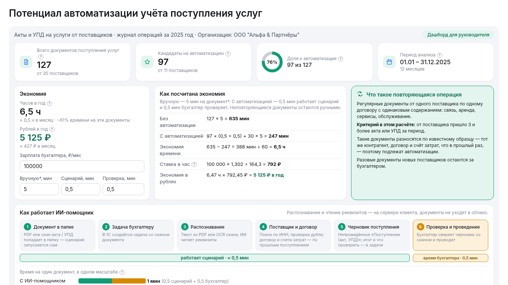

# Потенциал автоматизации учёта поступления услуг

**AI-Katalizator** · бесплатная обработка для «1С:Бухгалтерии предприятия 3.0»

Обработка показывает, сколько времени и денег сэкономит бухгалтер, если повторяющиеся акты за услуги будет готовить помощник, а бухгалтеру останется только проверить их и провести.



*Так выглядит страница для руководителя (на вымышленных данных).*

## Зачем это нужно

Почти в каждой компании есть поставщики, от которых акты приходят снова и снова: аренда, связь, интернет, уборка, охрана. Каждый такой акт бухгалтер вносит в 1С вручную, хотя он почти не отличается от прошломесячного. Обработка посчитает по вашей базе, сколько таких актов было за год и во что обходится их ручной ввод.

## Что вы увидите

После нажатия «Сформировать» вы увидите:

- сколько всего актов на услуги проведено за период и от скольких поставщиков;
- сколько из них повторяющиеся, то есть пришли от постоянных поставщиков, и какая это доля от всех актов;
- сколько часов и рублей в год можно сэкономить.

Результат показан в двух видах: наглядная страница для руководителя и печатный отчёт со списком поставщиков. Отчёт можно распечатать или сохранить в PDF.

## Какие документы учитываются

Учитываются только проведённые документы «Поступление (акт, накладная, УПД)» с видом операции «Услуги». Не учитываются поступления вида «Товары, услуги, комиссия», полученные счета-фактуры, а также непроведённые и помеченные на удаление документы.

Поставщик считается постоянным, если от него за период пришло 3 акта или больше. Это число можно поменять. Есть и более строгий вариант: поставщик считается постоянным, только если акты от него приходили хотя бы в 9 месяцах из 12.

## Безопасно для базы

Обработка только читает данные. Она ничего не записывает и не меняет в базе, не создаёт документов и никуда не отправляет данные: всё остаётся у вас.

Если отчёт нужно показать кому-то со стороны, включите «Обезличить поставщиков». Тогда вместо названий будет «Поставщик 1», «Поставщик 2» и так далее, а название организации скроется.

## Как запустить

1. Скачайте файл `PotencialAvtomatizaciiUslug_v002.epf` из папки [dist](dist/).
2. В 1С откройте главное меню (☰ или «Ещё»), выберите «Файл → Открыть…» (или нажмите Ctrl+O) и укажите скачанный файл.
3. 1С спросит, доверяете ли вы файлу. Так она спрашивает про любую внешнюю обработку. Подтвердите.
4. Выберите период (по умолчанию прошлый год) и организацию. Если организацию не выбирать, посчитаются все организации базы.
5. Нажмите «Сформировать».

Если 1С не даёт открыть файл, значит у пользователя нет прав на внешние обработки. Их выдаёт администратор базы. Подробная памятка для бухгалтера: [PDF](docs/Pamyatka_PotencialAvtomatizaciiUslug.pdf), [DOCX](docs/Pamyatka_PotencialAvtomatizaciiUslug.docx).

## Что можно настроить

Цифры для расчёта уже стоят по умолчанию, но их можно поменять под свою компанию прямо на форме:

- оклад бухгалтера: 100 000 ₽ в месяц;
- время на ручной ввод одного акта: 5 минут;
- время на акт с помощником: полминуты на подготовку и полминуты на проверку бухгалтером;
- с какого числа актов поставщик считается постоянным: 3.

Отчёт пересчитывается сразу, нажимать «Сформировать» заново не нужно. Только после смены периода или организации нужно снова нажать «Сформировать», потому что обработке надо заново прочитать документы из базы.

## Как считается экономия

Сравниваем, сколько времени уходит на акты сейчас и сколько будет уходить с помощником.

1. **Сейчас** бухгалтер вводит каждый акт вручную, по 5 минут на акт.
2. **С помощником** повторяющиеся акты готовит помощник, а бухгалтер только проверяет, по минуте на акт. Остальные акты по-прежнему вводятся вручную, по 5 минут.
3. Разница между этими двумя временами и есть экономия в часах.
4. Чтобы перевести часы в рубли, считаем стоимость часа бухгалтера: оклад плюс страховые взносы 30,2%, делённые на среднее число рабочих часов в месяце (164,3). При окладе 100 000 ₽ час стоит около 792 ₽.
5. Экономия в рублях равна сэкономленным часам, умноженным на стоимость часа.

**Контрольный пример.** За 2025 год в базе 127 актов на услуги от 35 поставщиков. Из них 97 актов (76%) пришли от 11 постоянных поставщиков.

- Сейчас: 127 актов по 5 минут, всего 635 минут.
- С помощником: 97 актов по 1 минуте и 30 актов по 5 минут, всего 247 минут.
- Экономия: 388 минут, то есть около 6,5 часа в год, или примерно 5 125 ₽ в год (около 427 ₽ в месяц).
- В строгом варианте «9 месяцев из 12» постоянными считаются 73 акта, а экономия получается 3 857 ₽ в год.

Экономия растёт вместе с числом актов: чем больше повторяющихся документов, тем больше выгода.

Откуда взяты 5 минут на документ: это рекомендация НИИ труда и социального страхования Минтруда (рекомендации от 07.03.2014 № 003, п. 3.7.1). Она носит рекомендательный характер, это подтверждает письмо Минтруда России от 27.08.2021 № 14-3/ООГ-8215. Время на подготовку и проверку с помощником указано по практической оценке. Все эти цифры можно поменять на форме.

## Версии

| Версия | Что нового | Статус |
|---|---|---|
| v001 | первая версия | проверена в 1С |
| v002 | можно выбрать организацию | проверена в 1С |

Что проверить при первом открытии: [чек-лист в PDF](docs/Checklist_proverki_v_1C.pdf) ([DOCX](docs/Checklist_proverki_v_1C.docx)).

## Для разработчиков

### Сборка без 1С

Платформа 1С для сборки не нужна. Нужны Python 3.10+ и [v8unpack](https://github.com/saby-integration/v8unpack) 1.2.15 (`build.sh` поставит его сам).

```bash
./build.sh            # тест расчёта + сборка dist/PotencialAvtomatizaciiUslug_v002.epf + проверки
./build.sh --bsl      # + статический анализ BSL Language Server (JAVA=<java 21+> BSL_LS_JAR=<jar>)
```

Сборка проверяет структуру контейнера, затем распаковывает готовый файл обратно и сравнивает модуль и метаданные с исходниками (round-trip). Протокол — `build/BUILD_REPORT.md`. Содержимое воспроизводится от сборки к сборке; меняются только случайные идентификаторы в служебном файле `versions`, как и у самой платформы.

### Устройство репозитория

```
src/bsl/ФормаМодуль.bsl     весь код: форма строится программно, запрос, расчёт, дашборд, печать
src/bsl/МодульОбъекта.bsl   модуль объекта (пустой)
src/html/dashboard_v10.html шаблон дашборда, встраивается в модуль при сборке
src/skeleton/               каркас метаданных: пустая обработка с одной управляемой формой
tools/build.py              сборка v8unpack, правка оглавления контейнера, проверки, round-trip
tools/patch_toc.py          размер блока оглавления 0x200 и фиксированное время файлов
tools/make_skeleton.py      как получен каркас src/skeleton из публичного образца
tools/v8container.py        простой читатель контейнера для проверок
tests/                      Python-зеркало формул и тест на модельных данных
dist/                       готовые файлы .epf
docs/                       памятка, чек-лист проверки, картинка
```

Форма в файле — пустая управляемая форма с реквизитом «Объект»; реквизиты, команды и элементы создаются в `ПриСозданииНаСервере`. Точка расширения для будущих сценариев — `НастройкиСценарияПоступлениеУслуг()`.

### Благодарности и использованные инструменты

- **[v8unpack](https://github.com/saby-integration/v8unpack)** (saby-integration, лицензия MIT) — распаковка и сборка файлов 1С из текстовых исходников. Каркас `src/skeleton` получен скриптом `tools/make_skeleton.py` из тестового файла этого репозитория `tests/ExternalDataProcessor803/ВнешняяОбработка803.epf`: оставлена только общая структура метаданных платформы (идентификаторы классов и типов платформы, пустая форма), имена и тексты образца удалены.
- **[1c-ai-dev-env](https://github.com/Pradushkoai/1c-ai-dev-env)** (Pradushkoai, лицензия MIT) — описание проблемы с размером блока оглавления после v8unpack (ADR-0007); исправление в `tools/patch_toc.py` написано самостоятельно по этому описанию.
- **[BSL Language Server](https://github.com/1c-syntax/bsl-language-server)** (1c-syntax, лицензия LGPL-3.0) — статическая проверка синтаксиса модуля; в репозиторий не входит.
- **[Pandoc](https://pandoc.org/)** и **[LibreOffice](https://www.libreoffice.org/)** — DOCX и PDF памятки и чек-листа.

### English summary

A read-only external data processor (`.epf`) for 1C:Accounting 3.0 (Russia). It scans posted service receipts («Поступление (акт, накладная, УПД)» with operation type «Услуги») for a period, finds repeating operations (documents from regular suppliers), and estimates how much bookkeeper time and money a review-only workflow would save. It shows a manager dashboard and a print form, can anonymize suppliers, and can filter by organization. It writes nothing to the database. The `.epf` is built from plain-text sources without the 1C platform, using [v8unpack](https://github.com/saby-integration/v8unpack). Status: v001 and v002 are checked in 1C. License: MIT.

## Лицензия

[MIT](LICENSE) © 2026 AI-Katalizator.

